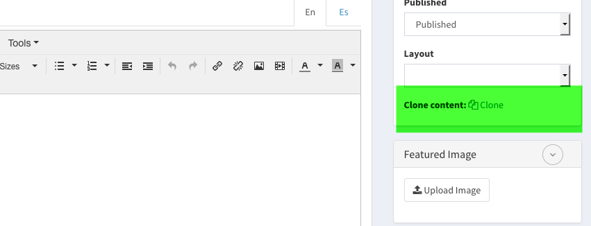

# Camaleon CMS - Post Clone
This is a Camaleon CMs Plugin which permit you to clone contents the current content with all related information.
The cloned content will include: categories, tags, custom fields (if enabled), custom settings,... and it will be saved as draft (if configured) or published (default).



## Installation
* Add to your Gemfile
```
gem "camaleon_post_clone"
```
* Install gem
```
bundle install
```
* Restart Server and activate the plugin: Admin -> plugins -> Camaleon Post Clone
* Configure the plugin by 'Settings' below the plugin title
* Edit any content and clone with the option in the right bar

## Development

The suite runs against a camaleon_cms-backed dummy Rails app under `spec/` (the Ruby version comes
from `.tool-versions`):

```bash
bundle install
(cd spec/dummy && RAILS_ENV=test bin/rails db:test:prepare)
bin/rspec
```

Lint with the same configuration CI enforces:

```bash
bin/rubocop
```

### What CI runs

Three sets of checks test this plugin. Two run on the events of this repository. One runs on the
events of camaleon_cms.

| Event | Check | Workflow | What it tests |
|---|---|---|---|
| A pull request or a `master` push in this repository | `CI / RSpec (camaleon_cms <version>)` and `CI / RuboCop` | `ci.yml` | The commit of this plugin, against the released camaleon_cms gem that `Gemfile.lock` pins |
| A pull request or a `master` push in this repository | `Camaleon master / Suite / RSpec` | `camaleon_master.yml`, which calls `core_compat.yml` | The commit of this plugin, against the `master` branch of camaleon_cms |
| A pull request or a `master` push in camaleon_cms | `camaleon-post-clone / RSpec`, on the camaleon_cms commit | `ecosystem.yml` of camaleon_cms, which calls `core_compat.yml` of this repository | The `master` branch of this plugin, against the camaleon_cms commit |

`core_compat.yml` holds the steps that run the suite against a camaleon_cms commit. It never starts
alone: one of the two callers in the table starts it.

The two checks against Camaleon code that is not released are advisory: a red check blocks no merge
and no release. In this repository, the job `Is master ahead of the release?` skips the suite when
Camaleon `master` has no commit after the release that `Gemfile.lock` pins.

### The suite against Camaleon `master`, locally

Point `CAMALEON_CMS_PATH` at a checkout of the `master` branch of camaleon_cms:

```bash
export RAILS_ENV=test CAMALEON_CMS_PATH=../camaleon-cms
bundle lock && bundle install
(cd spec/dummy && bin/rails db:test:prepare && bin/rails db:migrate)
bin/rspec
unset CAMALEON_CMS_PATH && git checkout Gemfile.lock spec/dummy/db/schema.rb && bundle install
```

The last line restores the lock and the schema of the released gem.

## Releasing

Bump `lib/camaleon_post_clone/version.rb`, cut a `## <version>` section in `CHANGELOG.md`, merge,
then run the **Release** workflow from the Actions tab on `master`, typing that same version. The
workflow refuses to run without a green CI run for the released commit, publishes the gem to
RubyGems, and creates the tag and GitHub release.
